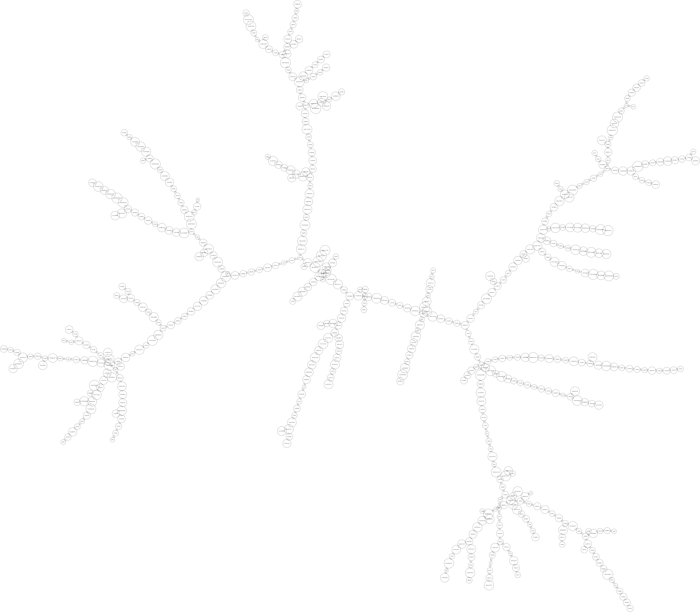

# Railway Freight Management System

[](https://github.com/fardeenmunaf/railway-freight-management/actions/workflows/ci.yml)


> Group project for the **Integrative Project (Sem3PI)** of the Informatics Engineering degree (LEI) at **ISEP**, 2025/26.

A system for managing freight on a European railway network: warehouses at train stations, picking and dispatching stock, planning and assembling trains, and analysing the rail network with graph algorithms. It also includes low-level code that controls track signals on a microcontroller.



*Minimum spanning tree of the Belgian railway network (559 stations), computed by the app and exported to Graphviz.*

## Highlights

- **Graph algorithms on real data:** shortest paths with negative costs (Bellman-Ford), max flow (Edmonds-Karp), hub centrality (Brandes betweenness and harmonic closeness), minimum spanning tree and topological sort with cycle detection, on a 559-station Belgian network
- **Spatial search over 62 000+ European stations** with a balanced 2D-tree: nearest neighbours, radius and range queries in microseconds to milliseconds
- **Warehouse logistics:** FEFO/FIFO stock dispatch, picking plans and a returns workflow with an audit log
- **Oracle database:** 47-table relational model with PL/SQL functions and triggers, runnable locally with one Docker command
- **Low-level programming:** RISC-V assembly routines and C programs that drive track light signals on a Raspberry Pi Pico
- **2062 automated tests**, run on every push by GitHub Actions

## Example

Option 15 finds the cheapest route between two Belgian stations. Some legs have negative costs, so it uses Bellman-Ford instead of Dijkstra:

```text
--- RESULT ---
Algorithm used: Bellman-Ford

Route: ANTWERPEN-C (37) -> ANTW-OOST (61) -> ANTW-BERCHEM (139) -> MORTSEL (863) -> ...

Legs:
   1. ANTWERPEN-C (37)             -> ANTW-OOST (61)                   0.82
   2. ANTW-OOST (61)               -> ANTW-BERCHEM (139)               5.74
   3. ANTW-BERCHEM (139)           -> MORTSEL (863)                    2.62
   4. MORTSEL (863)                -> LIERSESTWG (877)                 3.63
   5. LIERSESTWG (877)             -> HOVE (590)                      -2.25
   ...
```

## Repository layout

| Folder | Contents |
|---|---|
| [`freightMngt/`](freightMngt) | Java console application (Maven) and its 2062 unit tests. See its [README](freightMngt/README.md) for the full menu |
| [`sql-scripts/`](sql-scripts) | Oracle schema, sample data, queries and PL/SQL, one folder per user story |
| [`asm/`](asm) | RISC-V assembly and C programs, plus the Raspberry Pi Pico code |
| [`doc/`](doc) | Scrum artefacts and user story documentation |
| [`docker-compose.yml`](docker-compose.yml) | Local Oracle database with the schema and data already loaded |

## Running the Java application

Requirements: **JDK 23** and **Maven 3.9+**.

```sh
cd freightMngt
mvn test                      # build and run the 2062 tests
mvn -q dependency:build-classpath -Dmdep.outputFile=cp.txt
java -cp "target/classes:$(cat cp.txt)" app.Main
```

The app loads its sample data from CSV files on start-up (about 3 seconds) and opens a menu with 18 options. Everything except option 18 runs in memory, so no database is needed.

### Database (only for option 18, Train Assembly)

Requirements: **Docker**.

```sh
docker compose up -d          # from the repository root
docker compose logs -f        # wait for "DATABASE IS READY TO USE!" (1–2 minutes the first time)
```

This starts Oracle Database Free and loads the schema, sample data and PL/SQL functions from `sql-scripts/`. To use another Oracle database, set `FREIGHT_DB_URL`, `FREIGHT_DB_USER` and `FREIGHT_DB_PASSWORD`.

## Building the assembly and C code

The programs in `asm/` target **RISC-V** and are built on Linux with the RISC-V GNU toolchain (`riscv64-linux-gnu-gcc`) and run with QEMU. Each folder has its own `Makefile`. The `.ino` sketches run on a Raspberry Pi Pico.

## Team

| Name | GitHub |
|---|---|
| Diogo Remelgado | [@Dremel123](https://github.com/Dremel123) |
| Eduardo Pacheco | [@eduardo-pacheco7](https://github.com/eduardo-pacheco7) |
| Fardeen Munaf | [@fardeenmunaf](https://github.com/fardeenmunaf) |
| Guilherme Tavares | [@gatavares](https://github.com/gatavares) |
| Mariana Gabriel | [@marianargabriel](https://github.com/marianargabriel) |
