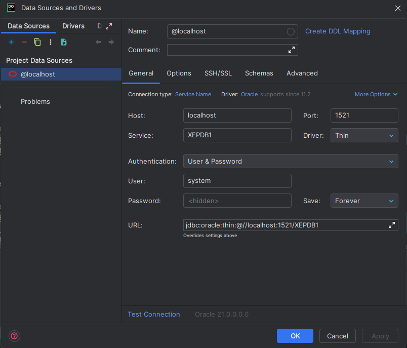

# 💾 Configuração do Oracle Database 21c XE com DataGrip

Este guia explica como preparar um banco de dados Oracle 21c Express Edition local, criar um usuário de aplicação (
`APPUSER`) e conectar o DataGrip corretamente à PDB (`XEPDB1`).

---

## 🧩 1. Instalar e iniciar o Oracle 21c XE

1. Download do instalador
   em [https://www.oracle.com/database/technologies/xe-downloads.html](https://www.oracle.com/database/technologies/appdev/xe.html)
2. Instale normalmente primeiro o `Oracle Database 21c Express Edition.msi` e de seguida o `setup.exe`.
3. Define uma password que te lembres ou aponta-a para mais tarde
3. Certifique-se de que os serviços estão em execução:
    - **Windows:** através do `Oracle Instance Manager (app) > oraDB21Home > OracleServiceXE`
4. O Oracle XE cria:
    - Um **CDB**: `XE`
    - Uma **PDB**: `XEPDB1` (onde ficam os dados da aplicação e a que deve ser usada)

---

### Listeners
Ir a `"C:\app\{USER}\product\21c\homes\OraDB21Home1\network\admin\"`

No `LISTNER= > Description_List > Descripton` adicionar:
```sql
(ADDRESS = (PROTOCOL = TCP)(HOST = localhost)(PORT = 1521))
(ADDRESS = (PROTOCOL = TCP)(HOST = {ipconfig network ipV4})(PORT = 1521))
```
E guardar.

## 🧠 2. Configurar o DataGrip

### Criar uma nova conexão Oracle:

1. Abra o **DataGrip → File → Data Sources → Add → Oracle**
2. Em **General**:

   * **Host:** `localhost`
   * **Port:** `1521`
   * **Connection type:** `Service name`
   * **Service name:** `XEPDB1`
   * **User:** `system` (para tarefas administrativas)
     ou `appuser` (para desenvolvimento)
   * **Password:** sua senha configurada
3. Verifique se a URL fica assim:

   ```
   jdbc:oracle:thin:@//localhost:1521/XEPDB1
   ```
4. Clique em **Test Connection** → deve aparecer *Oracle 21.0.0.0.0*.


---

## ⚙️ 3. Verificar se a PDB está aberta

Abra um terminal SQL (SQL*Plus, SQLcl ou DataGrip conectado como SYSDBA) e execute:

```sql
SELECT name, open_mode
FROM v$pdbs;
````

Só se `XEPDB1` estiver `MOUNTED`, abra e salve o estado:

```sql
ALTER PLUGGABLE DATABASE XEPDB1 OPEN;
      
ALTER PLUGGABLE DATABASE XEPDB1 SAVE STATE;
```

```sql
SELECT name, pdb, network_name FROM cdb_services ORDER BY 1; -- esperado ser XEPBD1 em tudo
```

---

## 👤 4. Criar o usuário da aplicação (`APPUSER`)

Conecte-se como `SYSTEM` (ou `SYS AS SYSDBA`) na PDB **XEPDB1**
e execute o script:

```sql
CREATE
USER appuser IDENTIFIED BY "YOURsTRONGpASSW0R$"
  DEFAULT TABLESPACE USERS
  TEMPORARY TABLESPACE TEMP
  QUOTA UNLIMITED ON USERS
  ACCOUNT UNLOCK;

GRANT CREATE
SESSION   TO appuser;
GRANT
CREATE TABLE TO appuser;
GRANT
CREATE SEQUENCE TO appuser;
GRANT
CREATE VIEW TO appuser;
GRANT
CREATE PROCEDURE TO appuser;
GRANT
CREATE TRIGGER TO appuser;
```

> 🔒 O Oracle não permite criar usuários locais no CDB (`CDB$ROOT`).
> Se você ver o erro `ORA-65096: nome de utilizador comum é inválido`,
> significa que ainda está conectado ao `CDB$ROOT`.
> Use o comando:
>
> ```sql
> ALTER SESSION SET CONTAINER = XEPDB1;
> ELECT SYS_CONTEXT('USERENV','CON_NAME') FROM dual;  -- deve retornar XEPDB1
> ```

---

## 🧮 5. Confirmar conexão com a PDB

No console SQL do DataGrip, execute:

```sql
SELECT SYS_CONTEXT('USERENV', 'CON_NAME')
FROM dual;
```

Se o resultado for:

```
XEPDB1
```

✅ você está no container certo.

---

## 📂 6. Testar criação de tabelas

Conectado como `APPUSER`, crie algo simples:

```sql
CREATE TABLE customers
(
    id    NUMBER GENERATED BY DEFAULT AS IDENTITY PRIMARY KEY,
    name  VARCHAR2(200) NOT NULL,
    email VARCHAR2(320) UNIQUE
);

INSERT INTO customers(name, email)
VALUES ('Ana', 'ana@example.com');

SELECT *
FROM customers;
```

---

## 🧹 7. Dropar tabelas com segurança (sem `IF EXISTS`)

O Oracle não suporta `DROP TABLE IF EXISTS`.
Use este bloco PL/SQL para dropar se existir:

```sql
BEGIN
EXECUTE IMMEDIATE 'DROP TABLE customers CASCADE CONSTRAINTS PURGE';
EXCEPTION
  WHEN OTHERS THEN
    IF SQLCODE != -942 THEN RAISE;
END IF;
END;
/
```

---

## 🧭 8. Erros comuns

| Erro                  | Causa                              | Solução                                        |
|-----------------------|------------------------------------|------------------------------------------------|
| ORA-65096             | Usuário criado no CDB root         | Conectar a `XEPDB1`                            |
| ORA-12514 / ORA-12505 | Listener não reconhece o serviço   | Use `Service name = XEPDB1`                    |
| ORA-01017             | Usuário/senha incorretos           | Confirme `appuser@XEPDB1`                      |
| ORA-01950             | Sem quota no tablespace            | `ALTER USER appuser QUOTA UNLIMITED ON USERS;` |
| ORA-00933             | Uso de `IF EXISTS` em `DROP TABLE` | Use PL/SQL de tratamento de erro               |

---

## ✅ 9. Conclusão

Depois desses passos você terá:

* Oracle XE 21c rodando localmente
* PDB `XEPDB1` aberta e configurada
* Usuário `APPUSER` pronto para uso no DataGrip
* Schema funcional para rodar seus scripts SQL completos

---

### Autor
Guilherme e Fardeen

Configuração automatizada seguindo passo a passo de ambiente Oracle XE com DataGrip.